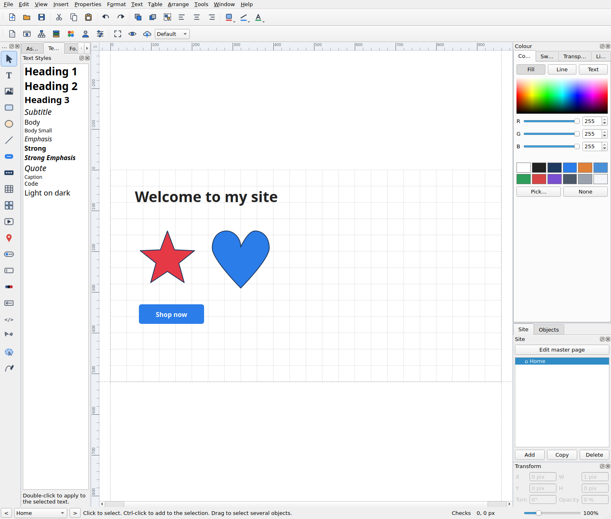

# WebPlus

A website designer for Linux. Drag text, pictures, buttons, forms and more onto a page,
link the pages together, and publish a clean site that fits any screen from a phone to a
wide monitor. No web knowledge needed, and no account, subscription or hosting from
anyone else: the finished site is plain files you put on **your own** web host.



Made by 4ThePeople Media. Licence: GNU GPL version 3 (see `LICENSE`).

## Install

### The easy way (Flatpak, any Linux)

Download `WebPlus.flatpak` from the Releases page, then:

```bash
flatpak remote-add --user --if-not-exists flathub https://dl.flathub.org/repo/flathub.flatpakrepo
flatpak install --user WebPlus.flatpak
flatpak run live.fourthepeople.WebPlus
```

It also appears in your applications menu. To build the Flatpak yourself from this folder:

```bash
flatpak install --user flathub org.kde.Platform//5.15-25.08 org.kde.Sdk//5.15-25.08 com.riverbankcomputing.PyQt.BaseApp//5.15-25.08
flatpak-builder --user --install --force-clean build-dir packaging/flatpak/live.fourthepeople.WebPlus.yml
```

To make a single file to send to someone:

```bash
flatpak-builder --force-clean --repo=repo build-dir packaging/flatpak/live.fourthepeople.WebPlus.yml
flatpak build-bundle repo WebPlus.flatpak live.fourthepeople.WebPlus
```

### From the source files

You need Python 3 and PyQt5, plus Pillow for picture effects and PhotoLab. On Linux Mint, Ubuntu or Debian:

```bash
sudo apt install python3-pyqt5 python3-pil
```

Then, from this folder:

```bash
bash install.sh
```

That puts **WebPlus** in your menu (Development), adds an icon, a `sitewright`
command, and makes `.site` files open with it. To run it without installing:

```bash
python3 sitewright.py
```

To remove it again: `bash uninstall.sh` (your sites are left alone).

Optional: `aspell` (spell checker, usually already there), `php` (only to test the
member and mailing-list pages on your own computer), and `poppler-utils` (only used by the tests).

## What it does

**Design**
- Text, pictures, rectangles, ellipses, lines, buttons, navigation bars
- Tables, photo galleries with lightbox, sliders, maps, YouTube and Vimeo, audio
- Forms with a Form Designer, mailing list sign-up, member login, site search
- Rollover pictures, lightbox on any picture, pop-up menus, show/hide actions
- Pages, a site tree, master page, starter templates and ready-made blocks
- Groups, alignment, rotation, locking, guides, undo and redo
- Compositions: save a group of objects and reuse it in any site

**Blog, polls and shop** (need a web host that runs PHP, except Shopify and WooCommerce links)
- A blog you write inside WebPlus: pictures, categories, search, a reader window, likes and comments you approve
- Web polls that count votes on your own host
- A shop: product cards, a product grid and a cart. Customers pay with PayPal, Stripe, your Shopify store or your
  WooCommerce store. Products can be typed in, imported from a CSV file, or brought in from Shopify or WooCommerce

**Drawing and pictures**
- Pen tool (click for corners, drag for curves), point editor, 17 ready-made shapes
- Crop a picture to any shape, with borders and glow that follow it
- PhotoLab: crop, turn, light and colour, sharpen, vignette. Phone photos come in the right way up
- Filter effects (blur, glow, black and white, sepia...), watermarks, a see-through colour

**Database Merge**
- Make a database (or import a CSV, or a folder of photos), draw one design in a repeating area, and the site repeats it for every record

**Looks**
- 12-colour schemes (change them and the whole site follows), site themes
- 30 gallery buttons and 10 navigation styles
- Gradients, shadows, saved styles, text styles, fonts

**For the web**
- Fits phones, tablets and any browser window automatically
- Clean addresses (`/about/`), page titles and descriptions, sitemap, social sharing tags
- RSS feed and podcast feed, Google and Bing verification, Analytics
- Members-only pages and a private mailing-list page (PHP hosts)
- Spell checker, anchors, Task Monitor that lists things to fix before you publish
- Publish by FTP (quick publish sends only what changed), or export a folder, or zip a backup
- Publish as a PDF with clickable links, export a picture of the page, or export objects as a one-file widget

## Your first site in ten minutes

See [docs/GUIDE.md](docs/GUIDE.md). The program also has the same help built in:
**Help > Help articles**.

## Your files

| What | Where |
|---|---|
| A site you are working on | a `.site` file (pictures are inside it; older `.sitewright` files still open) |
| The finished website | the folder you choose in **File > Export website** |
| Saved compositions | `~/.local/share/sitewright/compositions/` |
| Settings | your normal desktop settings (recent files, text size, FTP host name) |

Passwords you give for FTP are used for that upload only and are never written down.
Member passwords are scrambled the moment you type them.

## For developers

```
packaging/flatpak/      the Flatpak recipe, menu entry, file type and app description
THIRD_PARTY.md          every outside part and picture, with its licence
sitewright.py           start-up
sitewright/             the program
  window.py             main window, menus, docks
  canvas.py             the page and its selection handles
  extras.py, styles.py  drawing and HTML for each object kind
  export.py             writes the finished site
  phpgen.py             the small PHP files for members and the mailing list
  publish.py            FTP upload and its progress window
icons/ tools/           icon artwork and the script that draws it
tests/                  run: bash tests/run_all.sh
docs/                   guide, feature checklist, pictures
```

Run the tests with `bash tests/run_all.sh`; each line must say `ALL GOOD`. They use their own
settings folder. `tools/sweep.py` clicks every menu command on every kind of object and
reports any error (run it with `XDG_CONFIG_HOME=$(mktemp -d)` so it cannot change your settings).
`tests/test_php.py` starts PHP's own web server to check the sign-in and sign-up pages.
