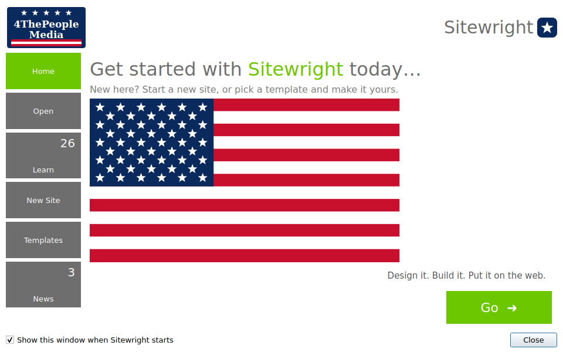
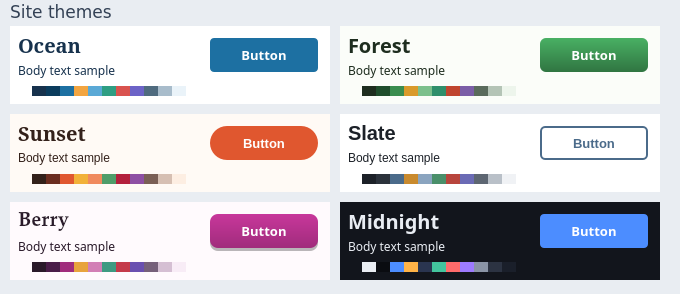
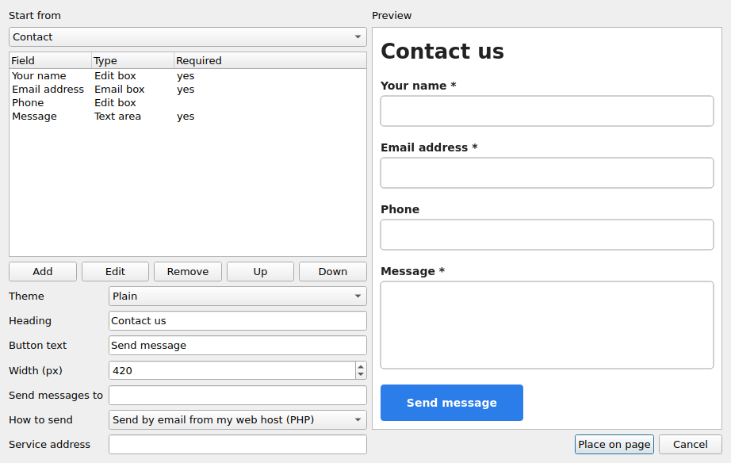
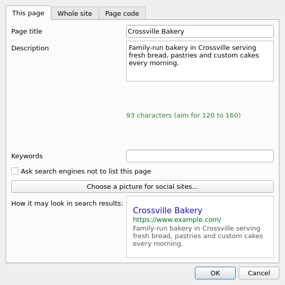

# WebPlus: a ten minute guide

## 1. Start
Open WebPlus from your menu. The **Startup Assistant** appears.

- **New Site**: give it a name, pick a colour scheme and a page width, say how many pages.
- **Templates**: six ready-made sites (business, portfolio, restaurant, church or group,
  event, blog). Pick one, then change anything you like.
- **Open**: your recent sites.

## 2. Find your way round

| Where | What it is |
|---|---|
| Left edge | **Tools**: pointer, text, picture, shapes, button, navigation bar, table, gallery, video, map, audio, form field, social buttons, scrolling message, HTML |
| Next to it | Tabs: **Text Styles**, **Fonts**, **Quick Build**, **Compositions**, **Assets** |
| Middle | The page. The colour runs the whole width, like the real site. Dashed lines mark your design area |
| Right | **Colour**, **Site** (your pages) and **Objects** (details of what you selected), **Transform** |
| Bottom | **Task Monitor**, page chooser, zoom |
| Top | Menus and two rows of buttons |

Drag the **Tools** panel by its title to float it over the page, or drag it back to lock it in.

- The toolbar buttons are pictures to save room. Rest the pointer on one to see its name, or
  choose **View > Toolbar buttons > Pictures with words**.
- Both toolbars have a dotted handle on the left. Drag it to move the bar to any edge of the
  window, or pull it right off to float it over the page. WebPlus remembers where you
  left everything. **Window > Lock toolbars in place** stops them being moved by accident, and
  **Window > Reset toolbars and panels** puts everything back.
- Every panel can be dragged narrower or wider by its edge. **F4** hides all the panels so the
  page gets the whole window; press it again to bring them back.
- The page opens at its real size (for example 960 wide). It only shrinks if the window is
  too small.

## 3. Put things on the page
1. Click a tool, then drag on the page where you want it.
2. Click the pointer tool to move and resize. Arrow keys nudge by one pixel
   (hold Shift for ten).
3. Double-click a text box, or press F2, to type in it.
4. Change the look in the **Objects** panel on the right.

Handy: **Ctrl+D** duplicates, **Ctrl+G** groups, **Ctrl+Z** undoes, **Ctrl+9** fits the page.

## 4. Pages and menus
- **Site** panel: **Add** a page, drag to nest or reorder, right-click for more
  (set as home page, leave out of menu, add an outside link).
- **Insert > Navigation bar from gallery** builds a menu from your pages and keeps it up
  to date. Put it on the **master page** (button at the top of the Site panel) and it shows
  on every page.
- Link any object to another page in the **Hyperlink** box in the Objects panel.

## 5. Make it yours
- **Tools > Colour scheme designer**: change the 12 site colours; the whole site follows.
- **Format > Site theme**: colours, fonts, buttons and menu style in one go.
- **Insert > Gallery button**: 30 button styles with hover and pressed looks.

## 6. Forms, contact page and more
- **Insert > Form designer**: pick Contact, Feedback, Booking or Newsletter, choose
  the fields and a look, then place it. Set where messages go in **Insert > Form email address**.
- **Insert > Site search and members**: search box and results, mailing list sign-up,
  member login. For members-only pages, add people in **Tools > Members and protected
  pages**, then tick **Members only** in a page's properties.
- **Insert > Slider**, **Photo gallery**, **YouTube video**, **Map**, **Table**.

## 6b. Drawing, shapes and pictures
- **Pen** (toolbox, or Insert > Pen): click for a corner, drag for a curve, double-click or Enter to finish,
  click the first point to close. **Insert > Shape** has 17 ready-made shapes.
- Double-click a shape (or right-click > Edit points) to move its points and curve handles, click the
  line to add a point, right-click a point to make it smooth or a corner. Esc finishes.
- **Format > Crop to shape** cuts a picture to a shape or to a shape you drew (select both).
- **Format > Edit photo (PhotoLab)**: drag on the picture to crop, turn it, change light and colour.
- **Format > Filter effects**, **Picture watermark**, **Picture transparency**.
- **Tools > Database Merge**: create a database, draw a repeating area, put fields in it, and the
  published page repeats the design for every record. **View > Show other records** previews them.

## 6c. Blog, polls and a shop
- **Tools > Blog manager** is where you write posts (pictures, categories, tags, drafts). **Insert > Blog** puts the
  blog on a page: readers get search, category buttons, a reading window, likes and comments. Comments wait for your
  approval: open `yoursite.com/blog-admin.php?key=YOUR KEY` (the key is on the Blog manager's second tab).
- **Insert > Web poll**: type the question and choices; votes are counted on your host (one vote per visitor).
- **Tools > Shop manager**: add products, choose how customers pay (PayPal, Stripe, Shopify or WooCommerce), set the
  currency, shipping and tax. Then **Insert > Shop > Product**, **Product grid** and **Shopping cart button**.
  Shopify and WooCommerce can fill in your product list for you. Money goes straight to the payment company or your
  store; WebPlus never sees card numbers.
- These need a host that runs PHP (blog comments and likes, polls, Stripe). Shopify, WooCommerce and the PayPal
  buttons work on any host.

## 7. Get found
Open **Properties > Search engine optimisation** for each page:
a clear title, one sentence description, and your site's web address (so a sitemap and
sharing tags can be made). The **Task Monitor** warns about anything missing.

## 8. Preview, then publish
- **F5** previews the site in your browser.
- **File > Publish site to the web (FTP)**: your host's FTP name, user name, password and
  folder. The password is not saved.
- **Quick publish** sends only what changed since last time.
- **File > Publish as PDF** makes a PDF with clickable links. **Export as picture** and **Export as widget** are next to it.
- **File > Export website** writes the finished site to a folder. **File > Back up site**
  makes a zip of the project and the site together.

## 9. If something does not work
- **Help > Help articles** explains each feature in plain words.
- The Task Monitor (bottom) lists problems and double-clicking one takes you to it.
- Members-only pages, the mailing list and the contact form need a host that runs **PHP**.
- Text too big in the program? **View > Interface text size**.
